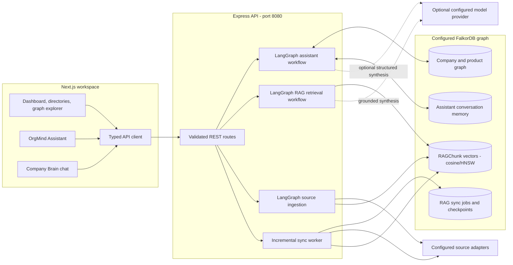
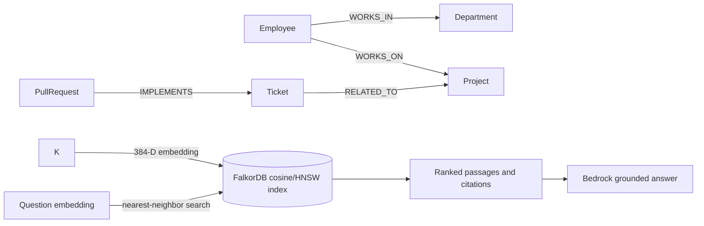
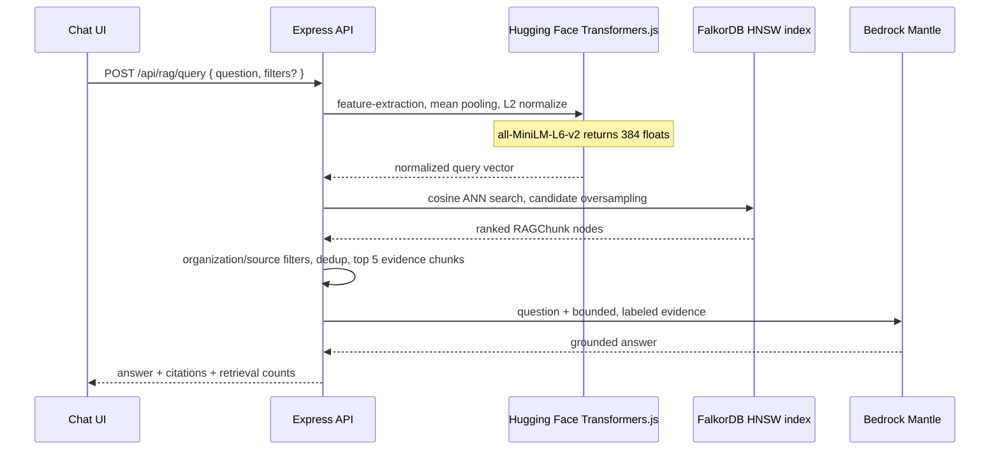

# OrgInGraphs

<p align="center">
  <strong>Turn company data into a living, queryable intelligence graph.</strong><br />
  Connect people, projects, decisions, documents, and engineering signals - then retrieve the evidence behind every answer.
</p>

<p align="center">
  
  
  
  
  
  
</p>

<p align="center"><b>384-dimensional semantic vectors</b> &nbsp; | &nbsp; <b>FalkorDB cosine/HNSW retrieval</b> &nbsp; | &nbsp; <b>Grounded Bedrock synthesis</b></p>

> **On the roadmap:** exploring [**gRPC**](https://grpc.io/docs/) for a future typed, high-throughput service boundary alongside today's REST API. This is future exploration, not a currently implemented transport.

OrgInGraphs (OIG) is a company intelligence platform built around a company graph and two specialized AI workflows. **OrgMind Assistant** reasons over graph entities, typed relationships, and bounded neighborhoods. **Company Brain** runs a retrieval-augmented generation (RAG) pipeline: it embeds the question, searches indexed graph chunks, assembles evidence, and asks the backend-configured Bedrock model for a cited response. That split keeps graph navigation and document-grounded synthesis explicit and inspectable.

> **Data scope:** the repository includes deterministic Hirenova demo records. Connector configuration and source-shaped API responses do not by themselves establish that data is live or verified. The backend filters synthetic records from verified source views and ingestion.

## System at a glance



The browser uses the frontend API client (`NEXT_PUBLIC_API_BASE_URL`, default `http://localhost:8080`). FalkorDB, model credentials, source credentials, and RAG administration keys are backend concerns. The UI does not invoke Bedrock directly.

## Architecture

### Frontend

The frontend is a Next.js App Router application built with React and TypeScript. Workspace pages use a shared shell and a typed API layer; graph exploration uses React Flow through `@xyflow/react`. Tailwind CSS provides the utility styling layer, with project styles in the app stylesheet. Lenis is included for smooth scrolling and Lucide supplies the icon set.

| Area | Implementation | Reference |
|---|---|---|
| Workspace and routes | Next.js App Router 15, React 19 | [Next.js](https://nextjs.org/docs), [React](https://react.dev/) |
| API access | `frontend/lib/api.ts`, base URL from `NEXT_PUBLIC_API_BASE_URL` | [Fetch API](https://developer.mozilla.org/docs/Web/API/Fetch_API) |
| Graph visualization | `@xyflow/react` | [React Flow](https://reactflow.dev/) |
| Styling | Tailwind CSS 4 and application CSS | [Tailwind CSS](https://tailwindcss.com/docs) |
| Interaction utilities | Lenis, Lucide React | [Lenis](https://lenis.darkroom.engineering/), [Lucide](https://lucide.dev/) |

**Primary UI surfaces:** dashboard, company/people/project views, graph explorer, integrations and source records, search, OrgMind Assistant, and Company Brain. The API client handles JSON requests and maps the RAG response into the frontend's typed response shape.

### Backend and graph model

The backend is a Node.js 20+ TypeScript service using Express 5 and the FalkorDB JavaScript client. It persists graph nodes by stable `id` and writes node properties through parameterized openCypher queries. Public graph responses use stable entity IDs and include relationships only when both endpoint nodes are part of the exposed company graph.

The company graph covers `Company`, `Employee`, `Department`, `Team`, `Project`, `Repository`, `Service`, `Document`, `Decision`, `Incident`, `Task`, `PullRequest`, `Channel`, and `Message`. Product Progress adds `Product`, `ProductModule`, `Feature`, `FeatureRequest`, `Ticket`, `Bug`, `Release`, `Commit`, `Comment`, `Activity`, and `Review`; organization labels such as `Employee`, `Department`, `Team`, and `Project` are reused. Product records are marked with `graphDomain: "product-progress"` and carry source/provenance fields.

Representative relationship families include reporting and membership (`REPORTS_TO`, `MEMBER_OF`, `WORKS_IN`), ownership and delivery (`OWNS`, `WORKS_ON`, `IMPLEMENTS`, `FIXES`), and product lineage/dependency (`HAS_FEATURE`, `HAS_TICKET`, `DEPENDS_ON`, `RELATED_TO`). Product Progress constrains returned node labels and relationship types through an allowlist.

The deterministic Hirenova seed graph includes company, department/team, employee, project/service, and source-shaped engineering records. Seed records are demo data; they are not evidence of a live provider connection.

## Why FalkorDB is central to OrgInGraphs

OrgInGraphs is built around FalkorDB's graph data model. That choice lets the application represent company knowledge as **typed nodes and typed relationships**, then traverse those relationships as first-class structure. An employee is not just a row with a department name: the graph can record and query `(:Employee)-[:WORKS_IN]->(:Department)`, ownership, reporting, project work, and the links among issues, pull requests, services, and decisions.

FalkorDB also hosts the RAG corpus in the same graph database. `RAGChunk` nodes carry source metadata and 384-dimensional vectors, while a native cosine/HNSW index finds semantically similar passages. The backend can then apply organization and source filters and return citations tied to the indexed graph records. This gives OrgInGraphs one graph-native persistence and query layer for **relationship traversal and semantic retrieval**, instead of maintaining disconnected graph and vector stores.



The graph provides the typed organizational structure and referential links; the vector index adds semantic recall over chunk text. The workflows combine those capabilities while preserving their distinct contracts: OrgMind follows graph entities and edges, and Company Brain retrieves text evidence and returns source citations.

## Agent and workflow layer

Workflows are implemented as explicit [LangGraph](https://docs.langchain.com/oss/javascript/langgraph/overview) `StateGraph` sequences. They validate input and dependencies, record stage/error state, and keep graph writes behind persistence/validation boundaries. These are bounded application workflows, not autonomous agents with unrestricted tool access.

| Workflow | State graph stages | Responsibility and safeguards |
|---|---|---|
| **OrgMind Assistant** | `validate -> classify -> retrieve -> synthesize -> validate_response` | Classifies company overview, entity, ownership, decision, impact, graph, or general questions; searches graph records and bounded direct neighborhoods; optionally synthesizes against a restricted evidence bundle; validates structured output and entity references. Deterministic graph-backed summaries remain available if model synthesis is disabled or invalid. |
| **Source ingestion** | `validate -> fetch -> process -> finish` | Validates a source and fetch limit, fetches through configured adapters, rejects untrusted/synthetic inputs where required, routes normalized records to processors, and returns per-record outcomes. Writes require backend admin authorization. |
| **Ticket identification** | identify → resolve → validate → persist | Parses issue fields, resolves referenced graph entities, validates ambiguity and provenance, then persists stable records only when validation succeeds. |
| **Feature/activity update** | classify → parse → resolve → validate → persist | Interprets source activity into graph updates, resolves references and validates before writing. Model-assisted parsing is constrained by the configured provider and validation rules. |
| **Document processing** | source-type routing | Sends Confluence documents to document persistence, Jira tickets to ticket processing, and supported GitHub/Slack records through activity/message handling. Unsupported source records can be skipped. |
| **Company Brain ingestion** | `discover_sources -> load_documentation -> extract_organization_data -> normalize_and_chunk -> generate_embeddings -> upsert_vector_store` | Discovers graph/API/document sources, skips unchanged hashes unless forced, chunks documents, embeds them, then upserts source chunks and records persistence failures. |
| **Company Brain retrieval** | `process_user_query -> generate_query_embedding -> retrieve_relevant_context -> generate_grounded_response -> format_response` | Validates the question, embeds it, retrieves and deduplicates relevant chunks, builds bounded evidence context, and asks the configured backend model to answer only from that evidence. Missing evidence and model failures are surfaced explicitly. |

### Company Brain: retrieval-augmented generation

Company Brain is an end-to-end RAG system over the organization's indexed knowledge. The pipeline combines a local Hugging Face sentence encoder, native FalkorDB vector search, source-aware ranking, bounded evidence assembly, and server-side Amazon Bedrock generation. Each stage has a defined input/output contract and contributes retrieval metadata and citations to the response.

#### 1. Semantic encoding with Hugging Face Transformers

The backend's `GeminiEmbeddingService` name is a legacy name; the default implementation is **not Gemini**. It dynamically imports `@huggingface/transformers` and initializes `pipeline('feature-extraction', 'Xenova/all-MiniLM-L6-v2')`. Text is mean-pooled and L2-normalized. Every embedding is exactly **384 finite numeric values** (384 dimensions); the implementation validates width and finiteness before accepting vectors. Batch inference defaults to 16 texts and supports bounded batches of 1-64. Offline/test mode uses a deterministic local hash embedding so tests do not download model assets; production defaults to the MiniLM transformer.

#### 2. Structure-preserving chunking and stable identity

The chunker keeps Markdown sections together when practical, groups paragraphs, and splits oversized paragraphs into sliding windows. Defaults are **2,000 characters per chunk** and **300 characters of overlap**. Chunk metadata carries organization ID, source type/path, title, document hash, content hash, timestamps, and available source metadata such as URL. Chunk IDs are deterministic from source path and chunk ordinal, with the document hash included in the standard chunking path. Unchanged sources are skipped by document hash, and graph MERGE semantics prevent ordinary reruns from blindly appending duplicate records.

#### 3. Native FalkorDB vector index and retrieval

Production vectors are persisted on `RAGChunk` nodes in the `embedding` property as `vecf32`. FalkorDB's vector index is configured for **384 dimensions**, **cosine similarity**, and **HNSW** with `M=16` and `efConstruction=200`. Initialization inspects `CALL db.indexes()`, reuses a compatible existing index, and creates one only when missing. Upsert writes node properties and vector data without redefining the index. Existing incompatible indexes are reported with the observed and expected settings; the error directs operators toward a side-by-side migration while preserving existing data.

Queries use `CALL db.idx.vector.queryNodes` to find nearest vectors. Candidate retrieval is oversampled to `topK * 8` (maximum 100), with inactive staged chunks excluded. Organization and source constraints are then applied; ranked results are deduplicated by content/hash and near-identical text, and query-specific summary records can be prioritized. The final evidence set is capped at **five chunks**. Citation records retain source title/type/platform, path, optional URL, excerpt, chunk identity, and similarity score.

#### 4. Evidence assembly and Bedrock generation

The retrieval graph builds an evidence context with an adjustable maximum size (default **16,000 characters**). Each passage is labeled with source and chunk identifiers (`[S1]`, `[S2]`, ...). The system prompt treats retrieved documents as untrusted input, tells the model to answer only from supplied evidence, requires factual claims to cite supplied labels, and asks the model to state uncertainty when evidence is insufficient or contradictory. When retrieval returns no qualifying chunks, Company Brain responds with an explicit insufficient-evidence message without calling the model.

When `AWS_BEARER_TOKEN_BEDROCK` is configured, `BedrockService` uses the OpenAI-compatible chat-completions client with Amazon Bedrock Mantle. The default model is **`openai.gpt-oss-120b`**. It receives a system prompt and a user prompt containing the question, available follow-up context, and bounded retrieved passages. Defaults are a 45-second timeout, 1,000 output tokens, and temperature `0.2`. Authentication/permission failures are surfaced directly; transient throttling, server, connection, and timeout failures receive up to three controlled attempts with exponential delay. The credential remains exclusively in backend runtime configuration.

If Bedrock is not configured, the RAG workflow reports that state as partial; if generation fails, it returns an explicit degraded response and error status. It does not silently select another model or claim a successful grounded answer.

#### Request and response contract

`POST /api/rag/query` accepts a strict JSON body with a required question and optional source-type filters:

```json
{
  "question": "What is the team working on?",
  "filters": { "sourceTypes": ["confluence", "jira"] }
}
```

The response contains `answer`, `sources`, `retrieval: { candidateCount, usedChunks }`, and `evidenceFound`. Each source entry includes `documentId`, `chunkId`, `citationIds`, `sourceType`, `title`, optional `url` and `excerpt`, and `score`. This keeps the generated answer auditable back to indexed chunks instead of presenting model text as unsupported fact.



**Incremental synchronization** is polling-based. The worker tracks `RAGSyncJob` work, leases, hashes/checkpoints, retries, and dead-letter replay in FalkorDB. It is not a CDC or webhook feed. Current connector adapters bound work per poll; absence from a partial scan is not sufficient evidence to delete an indexed source. Full re-scan/cleanup is guarded separately from selected-source ingestion.

### Integration boundary and provenance

Confluence supports a configured backend-side Atlassian REST connection. Jira, GitHub, and Slack fetching currently uses the configured `MOCK_API_BASE_URL` route contract; this repository does not include native provider REST clients for those three systems. The bundled route catalog and seed data provide source-shaped fixtures, not live company data. The ingestion pipeline uses provenance checks to reject records marked as synthetic and the source-library views expose only accepted user-provided or externally verified records.

`GET /api/integrations/status` reports configuration, indexed counts, and recorded sync outcomes. It does **not** actively verify upstream credentials or connectivity. A configured URL or key alone is not proof that a source is connected.

## API surface

The backend currently exposes Express routes directly; it does not publish an OpenAPI specification. The table below groups the main application contracts. See [`docs/api-capability-inventory.md`](docs/api-capability-inventory.md) for page mappings and integration details, and [`docs/rag-pipeline.md`](docs/rag-pipeline.md) for the complete RAG operations notes.

| Method and route | Request / response purpose |
|---|---|
| `GET /health` | Database connectivity status: `{ status, database }`; returns `503` when unavailable. |
| `GET /api/dashboard` | Company, graph snapshots, source counts, and aggregate totals for the workspace. |
| `GET /api/dashboard/summary` | Lightweight company, source counts, and totals. |
| `GET /api/graph` | Stable-ID graph `{ nodes, edges }` for company graph views. |
| `GET /api/company` | Company node; `404` if missing. |
| `GET /api/employees[?departmentId&teamId&employmentStatus]` | Employee list with optional filters. |
| `GET /api/employees/:employeeId` | Employee detail with manager, reports, department, team, skills, and projects. |
| `GET /api/departments[/:departmentId]` | Department records and associated teams/employees. |
| `GET /api/projects[/:projectId]` | Projects and associated contributors, owners, services, tasks, and pull requests. |
| `GET /api/graph/neighborhood/:entityType/:entityId` | Bounded direct neighborhood with relationship direction. |
| `GET /api/search?q=...` | Up to 50 name/title/email matches. |
| `GET /api/documents`, `/api/tickets`, `/api/conversations`, `/api/proactive-insights` | Paginated indexed records by source family; these read graph data rather than calling upstream APIs. |
| `GET /api/integrations/status` | Connector configuration and recorded sync/index status; not an active provider probe. |
| `GET /api/product-progress/graph` | Product Progress graph in the common node/edge response shape. |
| `POST /api/product-progress/tickets`, `/activities`, `/workflow` | Validated product/ticket/activity processing workflows. |
| `POST /api/assistant/query` | OrgMind structured graph answer; accepts `{ question, conversationId?, context? }`. |
| `GET /api/assistant/conversations[/:conversationId]` | Conversation listing or persisted turns for the supplied workspace identity. |
| `POST /api/rag/query` | Company Brain query; accepts `{ question, filters?: { sourceTypes? } }`. Returns `{ answer, sources, retrieval, evidenceFound }`. |
| `GET /api/rag/status` | Indexing, vector-store and sync-worker status. |
| `POST /api/rag/ingest`, `/api/rag/reindex`, `/api/rag/sync/replay` | Administrative ingestion, reindex, and dead-letter replay operations. |
| `POST /api/ingestion/process` | Administrative source fetch/process request, with per-record outcomes and safe diagnostics. |

The RAG response `sources` entries expose `documentId`, `chunkId`, `citationIds`, `sourceType`, `title`, optional `url`/`excerpt`, and `score`. The `/api/assistant/query` response is a different schema: `answer` is structured (`type`, `title`, `summary`, `findings`, `citations`, `related_entities`, `suggested_actions`, `uncertainty`) alongside a constrained `ui` description and `execution` stage statuses.

## Configuration and runtime topology

| Component | Runtime | Primary configuration |
|---|---|---|
| Frontend | Next.js on port `3000` in local defaults | `NEXT_PUBLIC_API_BASE_URL` points to the backend API. |
| Backend | Node.js `>=20`, Express 5 on port `8080` by default | [Node.js](https://nodejs.org/docs/latest/api/), [Express](https://expressjs.com/); `PORT`, `NODE_ENV`, `FRONTEND_ORIGINS`, `ORGANIZATION_ID`. |
| Graph database | FalkorDB | [FalkorDB](https://docs.falkordb.com/); `FALKORDB_HOST`, `FALKORDB_PORT`, username/password, TLS, and graph/database selection. |
| Embeddings | Local Hugging Face Transformers model by default | [Transformers.js](https://huggingface.co/docs/transformers.js); `RAG_EMBEDDING_PROVIDER`, chunk and context limits. |
| Answer model | Optional backend model provider; Bedrock Mantle is the configured RAG integration | [Amazon Bedrock](https://docs.aws.amazon.com/bedrock/); `AWS_BEARER_TOKEN_BEDROCK`, `AWS_REGION`, `BEDROCK_MANTLE_BASE_URL`; model `openai.gpt-oss-120b`. |
| Source adapters | Backend-side Confluence or configured route-catalog connector | Confluence base URL/email/token; `MOCK_API_BASE_URL` and source adapter credentials. |
| RAG administration | Backend only | `RAG_ADMIN_API_KEY` for protected write/maintenance routes. |

The relevant variable names and example values are maintained in [`backend/.env.example`](backend/.env.example). Credential values belong only in backend runtime configuration; never expose them in browser bundles or `NEXT_PUBLIC_*` variables.

## Security, safety, and operational limits

- **Authentication boundary:** the current backend has no authentication middleware. RAG identity and assistant memory ownership use the `x-orgmind-user-id` header, which is a demo identity and can be spoofed by a client. Do not treat it as authorization in a public deployment; bind ownership to a trusted server-side session or verified token.
- **Administrative writes:** ingestion, reindex, replay, and other write operations require the configured backend admin key and valid identity handling. Keep `RAG_ADMIN_API_KEY` and provider credentials on trusted server-side callers.
- **Prompt-injection boundary:** retrieved documents are explicitly treated as untrusted evidence. The Company Brain prompt limits responses to retrieved content and valid citation labels; deterministic no-evidence behavior is defined in the workflow.
- **Structured output:** OrgMind model output is validated against a strict schema and known graph IDs. Invalid or unavailable model output falls back to a deterministic graph-grounded response.
- **Impact semantics:** impact analysis is bounded graph traversal over recorded direct relationships. It is not causal analysis, risk scoring, or simulation.
- **Sync semantics:** synchronization is polling/checkpoint based, not real-time CDC. Partial source absence does not authorize deletion.
- **Provider health:** integration status is configuration/index reporting, not proof of successful upstream authentication or current availability.
- **Synthetic data:** fixture records must not be represented as real organizational data. Current API contracts and limitations are also tracked in [`docs/api-capability-inventory.md`](docs/api-capability-inventory.md).

## Repository map

```text
backend/
  src/api/                         Express routes and request validation
  src/agents/company-assistant/    Graph assistant memory and response types
  src/agents/organization-intelligence/
    workflow/                      RAG ingestion and retrieval graphs
    embeddings/                    Embedding provider
    vector-store/                  FalkorDB and local persistence adapters
    sync/                          Polling sync worker, queue and change checks
    sources/                       Source discovery and adapter/catalog loaders
  src/workflow/                    Assistant, ingestion, ticket and activity workflows
  src/graph/                       Public company graph projection
  src/db/                          FalkorDB query and persistence layer
  scripts/                         Seed, RAG rebuild and verification commands
  tests/                           Backend API, workflow, graph, ingestion and RAG tests
frontend/
  app/                             Next.js App Router pages and global styles
  components/                      Workspace, assistant, graph and data views
  lib/api.ts                       Frontend API client and response mapping
docs/
  rag-pipeline.md                  RAG, index, sync and operational details
  api-capability-inventory.md      Verified route inventory and integration limits
```

## Further reading

- [RAG pipeline and synchronization](docs/rag-pipeline.md)
- [API capability inventory](docs/api-capability-inventory.md)
- [Backend environment template](backend/.env.example)

<p align="center"><sub>OrgInGraphs · graph-grounded company intelligence</sub></p>
